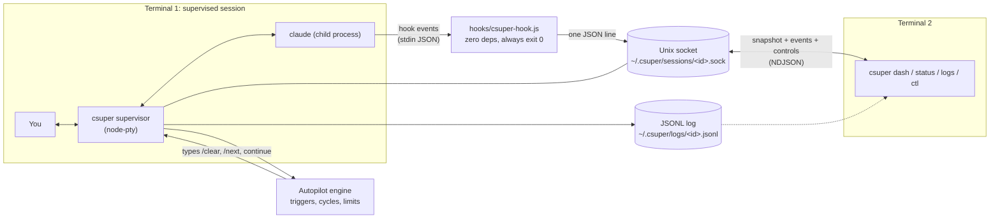

# csuper

**A supervisor and terminal dashboard for [Claude Code](https://claude.com/claude-code).** It runs `claude` inside a pseudo-terminal, watches what Claude Code reports through hooks, and keeps long, multi-phase sessions going without you babysitting them: it chains tasks, waits out usage limits and resumes, fails over from Opus to Sonnet, checkpoints your work in git, and stops itself when something looks wrong.

[](https://github.com/maanit-gupta/csuper/actions/workflows/ci.yml)
-lightgrey)


> **Status: v0.1.0, early but tested.** 144 unit/TUI tests plus an end-to-end suite that drives the built CLI in a real pty. macOS on Apple Silicon only. See [Limitations](#limitations).

---

## Contents

- [What it does, in one minute](#what-it-does-in-one-minute)
- [The problem it solves](#the-problem-it-solves)
- [Quick start](#quick-start)
- [Features](#features)
  - [The autopilot](#the-autopilot)
  - [The dashboard](#the-dashboard)
  - [Adopting existing conversations](#adopting-existing-conversations)
  - [Scriptable commands](#scriptable-commands)
- [How it works](#how-it-works)
- [Configuration](#configuration)
- [Files and environment variables](#files-and-environment-variables)
- [Safety model](#safety-model)
- [Repository layout](#repository-layout)
- [Development and testing](#development-and-testing)
- [Design notes and trade-offs](#design-notes-and-trade-offs)
- [Limitations](#limitations)
- [Roadmap](#roadmap)
- [Documentation map](#documentation-map)
- [License](#license)

---

## What it does, in one minute

```text
Terminal 1                              Terminal 2
┌───────────────────────────┐           ┌────────────────────────────────────────┐
│ $ csuper                  │           │ $ csuper dash                          │
│ (claude, looks unchanged) │  socket   │  Session   │ Rate limits │ Cycles      │
│                           │◄─────────►│  Triggers  │ Git/handover│ Log stream  │
│  … ::DONE::               │           │  live state, pause/resume, countdowns  │
└───────────────────────────┘           └────────────────────────────────────────┘
```

1. `csuper` starts `claude` exactly as you would, in a pty, with its output passed straight through. Claude Code looks and behaves as usual.
2. A small hook script, registered for that run only, reports what Claude does (tool results, final messages, limit errors, model switches) back to csuper over a private Unix socket.
3. When Claude ends a message with a keyword such as `::DONE::`, csuper runs a **checked** `/clear` then `/next` cycle so the next phase starts with a clean context. If Claude hits a usage limit, csuper waits for the reset (keeping the Mac awake), then types `continue` and verifies it worked.
4. In a second terminal, `csuper dash` shows all of that live, and lets you pause, cancel or skip waits.

## The problem it solves

Claude Code is excellent interactively, but multi-hour work has friction:

- A big job is best split into **phases**, each started from a clean context (`/clear`) with a handover note. Doing that by hand means being at the keyboard when each phase ends.
- **Usage limits** (5-hour, weekly, Opus-only) stop a session cold. You come back hours later to find nothing happened since the limit message.
- If something goes wrong (tool calls failing in a loop, the same file being edited back and forth), an unattended session can burn through budget doing nothing useful.
- There is no at-a-glance view of "what is my session doing right now, and is it healthy?"

csuper handles those four things and is deliberately conservative about it: every automated action is **confirmed or it stops** (see [Safety model](#safety-model)).

## Quick start

**Requirements:** macOS 13+ on Apple Silicon, Node.js ≥ 20, Claude Code on your `PATH`. Full list and troubleshooting: [INSTALL.md](INSTALL.md).

```bash
git clone https://github.com/maanit-gupta/csuper.git && cd csuper
npm install && npm run build && npm link      # puts `csuper` on your PATH

csuper                # terminal 1: claude, supervised
csuper dash           # terminal 2: the dashboard
```

Try the dashboard without Claude at all:

```bash
npm run demo          # a simulated session you can watch with `csuper dash`
```

Inside the supervised terminal, **Ctrl+G** toggles the autopilot (instead of opening Claude's external editor). Press `?` in the dashboard for its keys.

The autopilot's `/next` step assumes you have a `/next` slash command in Claude Code that tells Claude to start the next phase of your plan (csuper does not ship one; it sends whatever commands your trigger lists). If you only want the dashboard, limit handling and checkpoints, you can change a trigger's `commands` to `[]` in the config.

---

## Features

### The autopilot

Implemented in [`src/supervisor/autopilot.ts`](src/supervisor/autopilot.ts). It is driven entirely by Claude Code hook events plus the terminal output, and written I/O-free so the whole thing is unit-tested with a stub Claude and fake timers.

**Keyword triggers.** The *last non-empty line* of Claude's final message (from the `Stop` hook) is matched against configured keywords:

| Keyword (default) | Trigger | What happens |
|---|---|---|
| `::DONE::` | `task_complete` | Save the final message as a handover, make a git checkpoint, then a checked `/clear` → `/next` cycle |
| `::BLOCKED::` | `human_escalation` | Pause autopilot and send a macOS notification: Claude needs you |
| `::COMPLETE::` | `all_complete` | Pause autopilot and notify: the whole job is finished |

**Checked cycles.** A `/clear` → `/next` cycle is eight steps, and each one must be confirmed by a real signal within `autopilot.cycle_step_timeout_ms` (default 30 s):

| # | Step | Confirmed by |
|---|---|---|
| 1 | `::DONE::` detected | `Stop` hook |
| 2 | Countdown (`pre_clear_delay_ms`, 5 s; cancel with `c` in the dashboard) | timer |
| 3 | `/clear` sent | typed into the pty |
| 4 | `/clear` confirmed | `SessionStart` hook with `source: clear` |
| 5 | Claude idle | terminal quiet for `idle_quiet_ms` |
| 6 | `/next` sent | typed into the pty |
| 7 | New turn confirmed | `UserPromptSubmit` / `UserPromptExpansion` hook |
| 8 | Cycle done | recorded with duration and the phase `/next` started |

If a confirmation never arrives, the cycle **fails**, autopilot **pauses** (`cycle_failed`), you get a notification, and it is logged. Nothing is retried blindly. `max_auto_cycles_per_session` (default 20) stops the autopilot after N successful cycles.

**Usage limits.** Detected from the `StopFailure` hook (`error: rate_limit`) first and the on-screen banner second. Every raw limit message is saved to `~/.csuper/logs/ratelimit-samples.jsonl` so the parser can be improved from real data. Then:

1. wait until the reset time plus `reset_margin_seconds` (90 s), holding the Mac awake with `caffeinate -i`;
2. send `resume_prompt` (`continue`);
3. **verify**: a new turn must start with no new limit message within `resume_verify_seconds` (60 s);
4. if Claude is still limited, reschedule; after `max_failed_resumes` (3) in a row, pause and notify;
5. if the reset time can't be parsed, retry after 5 minutes, doubling up to 30 minutes, and never give up for good.

**Model failover.** An Opus-only cap switches to `/model sonnet` and continues immediately, then switches back to Opus between `/clear` and `/next` once the Opus window resets (`rate_limits.model_failover_order`).

**Circuit breakers** (all pause the autopilot rather than killing anything):

- `max_consecutive_tool_failures` (default 5) tool failures in a row;
- `max_auto_cycles_per_session`;
- `active_hours` (`always`, or a local `HH:MM-HH:MM` window that may wrap midnight);
- repeated edits to the same file within 10 minutes are counted and shown as an *edit-thrash* anomaly.

**Git checkpoints and handovers.** On `::DONE::`, if the working tree is dirty csuper commits `chore(csuper): checkpoint (<trigger>)`. A copy of Claude's final message goes to `.claude/csuper-handovers/` in the project (git-ignored, and it never touches your own `handover.md`).

### The dashboard

`csuper dash` is a full-screen, live terminal UI built with [Ink](https://github.com/vadimdemedes/ink) (React for CLIs). It never touches the supervised pty; it only talks to the supervisor's socket. Panels:

| Panel | Shows |
|---|---|
| **Session & Autopilot** | Session ID, project, ON / OFF / PAUSED (and why), active model, cycles used vs max, active-hours state, uptime, `claude` PID |
| **Rate Limits** | `ok` / `waiting` / `resuming` / `failover`, which limit, reset time, resume countdown, attempts, total time waited, `caffeinate` PID |
| **Cycles** | Completed/max, failures, the live step ("4/8 waiting for clear confirmation, times out in 18 s"), last 10 cycles with duration, result and phase |
| **Triggers & Anomalies** | Recent keyword hits, live `/clear` countdown, tool-failure streak vs threshold, edit-thrash counters |
| **Git & Handover** | Last checkpoint commit, recovery stashes, scrollable preview of the handover file |
| **Log stream** | Live JSONL log, colored by level, filter by level or text |

| Key | Action | Key | Action |
|---|---|---|---|
| `p` | pause / resume autopilot | `l` | full-screen log |
| `c` | cancel the `/clear` countdown | `/` | filter logs by text |
| `w` | skip a rate-limit wait (asks y/N) | `f` | cycle log level filter |
| `s` | switch session | `h` | toggle handover preview |
| `Tab` / `1`–`6` | move focus / jump to panel | `?` | help |
| | | `q` / Ctrl+C | quit dashboard (session keeps running) |

The dashboard reconnects with exponential backoff (up to 10 s) and shows `DISCONNECTED` while the supervisor is away. Countdowns are computed from absolute timestamps, so they stay correct even if events are delayed.

### Adopting existing conversations

`csuper adopt` brings ordinary Claude Code conversations, running or ended, into csuper without losing history. It runs `claude --resume <id>` under csuper in the conversation's own folder.

```bash
csuper adopt                      # picker over every project, newest first (Space multi-selects)
csuper adopt 1073635c             # by ID or unique prefix
csuper adopt --latest             # newest conversation for this folder
csuper adopt --all-live           # everything currently open in claude
csuper adopt 1073635c --dry-run   # show the plan, change nothing
csuper resume                     # same as `adopt <id> --here` for the current folder
```

Safety rules worth knowing: a conversation that is still open is **refused** (two processes appending to one transcript would corrupt it) unless you pass `--stop-original` (asks y/N, SIGTERM only, never SIGKILL) or `--fork` (continue a copy under a new ID). Claude Code's transcripts in `~/.claude` are only ever *read*. Adopted sessions **start with autopilot paused**. Details and all flags: [INSTALL.md → Adopting existing sessions](INSTALL.md#adopting-existing-sessions).

### Scriptable commands

```bash
csuper sessions [--json] [--prune]
csuper status   [--session <id>] [--json]
csuper logs     [--session <id>] [-f] [--level warn] [--event anomaly.detected] [--since 2h] [-n 200] [--raw]
csuper ctl      [--session <id>] pause|resume|cancel-countdown|skip-wait [--yes]
```

`csuper status` is built for shell prompts and scripts. Its exit code summarizes health:

| Code | Meaning |
|---|---|
| `0` | Running, autopilot on, no problems |
| `1` | Autopilot paused, or waiting on a rate limit |
| `2` | Session not found, or ambiguous (several live sessions, none chosen) |
| `3` | Anomaly active, breaker tripped, cycle failed, or gave up on a limit |
| `4` | Daemon not responding (stale socket) |

`--json` prints the same state object the dashboard renders. `logs --raw` emits JSONL for `jq`:

```bash
csuper logs --event anomaly.detected --raw | jq .data
```

---

## How it works



**The supervisor** ([`src/supervisor/supervisor.ts`](src/supervisor/supervisor.ts)) spawns `claude` under `node-pty`, forwards the terminal unchanged, and owns everything that can touch it. It is the *only* process that ever writes keystrokes to Claude.

**Hooks, not screen-scraping, are the source of truth.** csuper launches Claude with `claude --settings '{"hooks": …}'`, which Claude Code merges with your settings for that run only. Your `.claude/settings.json` is never edited, and a plain `claude` doesn't run the hook. The hook ([`hooks/csuper-hook.js`](hooks/csuper-hook.js)) has no dependencies, never prints, caps itself at 1.5 s and always exits `0`, so it cannot block or break Claude. The terminal is a fallback: usage-limit banners seen only on screen are acted on after `pty_fallback_grace_ms` if no hook reported them.

**The socket protocol** ([`src/protocol.ts`](src/protocol.ts)) is newline-delimited JSON, version 1:

```jsonc
// client → supervisor
{"type":"subscribe","v":1}
{"type":"control","v":1,"action":"autopilot.pause"}   // pause | resume | countdown.cancel | ratelimit.skip_wait

// supervisor → client
{"type":"snapshot","v":1,"state":{ /* full DashState */ }}
{"type":"event","v":1,"event":"state.patch","ts":"…","data":{ /* partial state */ }}
{"type":"log","v":1,"line":{ /* one JSONL log record */ }}
{"type":"ack","v":1,"action":"autopilot.pause","ok":true,"error":null}
```

Each dashboard gets a bounded buffer (`subscriber_buffer_msgs`, 1000). A client that stops reading is dropped rather than slowing the supervisor, so a frozen dashboard can never affect the session.

**One source of state.** Everything the UI and `status --json` show is one `DashState` object ([`src/state.ts`](src/state.ts)); the supervisor patches it and fans out the diffs.

**Logging.** Per-session JSONL at `~/.csuper/logs/<id>.jsonl` with local-offset ISO timestamps, rotated at `log_max_bytes` (10 MiB, 5 files kept). A hard rule across `src/`: **nothing writes to stdout/stderr while a pty is live** (the pty owns the screen). Diagnostics go to the log.

**Build.** [`scripts/build.mjs`](scripts/build.mjs) bundles the CLI and the TUI with esbuild into `dist/`. Ink, React, zod and yaml are dev-dependencies baked into the bundle; the only runtime dependency is `node-pty`. The TUI is a separate bundle so one-shot commands start fast.

## Configuration

All settings live in [`csuper.config.yaml`](csuper.config.yaml) (every key documented inline). Resolution order: `$CSUPER_CONFIG`, then `./csuper.config.yaml`, then `~/.csuper/csuper.config.yaml`. Built-in defaults equal the shipped file, so running with no config behaves identically. Config is validated with zod ([`src/config.ts`](src/config.ts)); an invalid value is rejected with a clear message rather than silently ignored (for example `max_consecutive_tool_failures: 0` is an error, not "unlimited").

The most useful knobs:

```yaml
triggers:                             # which keywords do what
  - { name: task_complete, keyword: "::DONE::", commands: ["/clear", "/next"], git_checkpoint: true }
pre_clear_delay_ms: 5000              # your window to cancel before /clear
autopilot:
  cycle_step_timeout_ms: 30000        # every cycle step must confirm in time or the cycle fails
rate_limits:
  auto_resume: true
  resume_prompt: "continue"
  reset_margin_seconds: 90
  model_failover_order: ["opus", "sonnet"]
  circuit_breakers:
    max_auto_cycles_per_session: 20
    active_hours: "always"            # or "22:00-07:00"
anomalies:
  max_consecutive_tool_failures: 5
adopt:
  default_autopilot: false            # adopted sessions start paused
```

Rule for contributors: a config key must exist in **both** `csuper.config.yaml` and the schema in `src/config.ts`.

## Files and environment variables

Everything lives under `~/.csuper` (or `$CSUPER_HOME`):

```text
~/.csuper/
├── csuper.config.yaml            # optional global config
├── sessions/<id>.sock            # one Unix socket per live session (0600, dir 0700)
├── sessions/<id>.json            # registry entry: pid, claude_pid, cwd, started_at, version, adoptedFrom…
└── logs/
    ├── <id>.jsonl                # per-session log (rotated to <id>.1.jsonl …)
    ├── dash.jsonl                # the dashboard's own diagnostics
    ├── adopt.jsonl               # csuper adopt
    └── ratelimit-samples.jsonl   # every raw usage-limit message, with how it was parsed
```

| Variable | Purpose |
|---|---|
| `CSUPER_HOME` | Replaces `~/.csuper` |
| `CSUPER_CONFIG` | Explicit config file |
| `CSUPER_SESSION` | Default session ID for `dash` / `status` / `logs` / `ctl` |
| `CSUPER_CLAUDE_BIN` | Path to `claude` if it isn't on `PATH` |
| `CSUPER_NOTIFY_LOG` | Append notifications to this file instead of showing them (used by tests) |
| `CSUPER_TAB_LAUNCHER` | Override how `adopt --tabs` opens tabs (used by tests) |
| `NO_COLOR` | Disable color |
| `CSUPER_SESSION_SOCK` | Set by csuper for the hook script (internal) |

## Safety model

- **Confirm or stop.** No automated keystroke is fire-and-forget. A missing confirmation pauses the autopilot and tells you.
- **Narrow remote control.** The socket accepts only `subscribe` and four control actions (pause, resume, cancel countdown, skip wait). There is no way to send free text to the pty, run commands, or change config through it. Anything else is rejected by an allow-list.
- **Local-only, owner-only.** Unix sockets with mode `0600` in a `0700` directory; no network listener, no tokens, nothing leaves your machine. csuper makes no network requests of its own.
- **Never kills what it doesn't own.** `adopt --stop-original` sends SIGTERM only after a y/N, never SIGKILL, and never signals itself, its parent `claude`, or an already-supervised session.
- **Doesn't modify Claude Code.** Hooks are injected per run with `--settings`; transcripts in `~/.claude` are read-only to csuper.
- **Child-session markers are stripped.** If you start csuper from inside Claude Code, the `CLAUDECODE`-style markers are removed from the child's environment so it still saves transcripts; your auth and config variables pass through untouched ([`src/supervisor/child-env.ts`](src/supervisor/child-env.ts)).
- **Dashboard isolation.** A crashed or slow dashboard cannot affect the session (bounded buffers, non-blocking writes). The terminal is always restored on exit, including on SIGINT/SIGTERM.

## Repository layout

```text
src/
├── supervisor/
│   ├── supervisor.ts      # pty host, Ctrl+G, hook registration, tool-failure and edit-thrash tracking
│   ├── autopilot.ts       # triggers, checked cycles, rate-limit waits, model failover (I/O-free)
│   ├── limits.ts          # usage-limit message parsing, phase parsing, active-hours
│   ├── host.ts            # side effects: notifications, caffeinate, git checkpoint, handover, samples
│   ├── claude-sessions.ts # reads ~/.claude to list/classify conversations (for adopt)
│   ├── stop-original.ts   # the careful SIGTERM-and-wait sequence
│   └── child-env.ts       # environment scrubbing for the claude child
├── cli/                   # main.ts router; dash/DashView + panels/ (Ink); status, logs, sessions, ctl, adopt, client
├── ipc-server.ts          # socket server: subscribers, control allow-list, snapshot + patch fan-out
├── protocol.ts            # message types + validation + NDJSON line parser
├── state.ts               # DashState shape and initial state
├── session-registry.ts    # ~/.csuper/sessions/* read/write, stale detection, pruning
├── logger.ts, log-filter.ts, paths.ts, config.ts
hooks/csuper-hook.js       # the zero-dependency Claude Code hook
scripts/                   # build.mjs (esbuild), demo-daemon.ts (simulated session)
tests/                     # vitest unit + TUI snapshot tests; e2e/ drives the built CLI in a pty
docs/dashboard-spec.md     # the design spec the dashboard was built against
```

## Development and testing

```bash
npm test             # 144 unit + TUI snapshot tests (vitest)
npm run typecheck
npm run build        # bundle to dist/
npm run test:e2e     # drives the built CLI in a real pty (uses a Python venv with pyte, created on first run)
npm run demo         # simulated session for trying the dashboard
```

The e2e suite runs against a throwaway `CSUPER_HOME` and `CLAUDE_CONFIG_DIR` with a fake `claude` (`tests/e2e/fake-claude.mjs`), so it never touches your real `~/.csuper`, `~/.claude` or account. An opt-in smoke test against the real `claude` exists (`CSUPER_E2E_REAL=1 npm run test:e2e -- real`, costs a few cents). CI runs typecheck, tests and build on a macOS Apple Silicon runner. See [CONTRIBUTING.md](CONTRIBUTING.md).

## Design notes and trade-offs

These are the judgment calls behind the code, and where it is honest about its edges.

- **Trust signals, not timing.** The first instinct for automation like this is `sleep 5; type /clear`. csuper instead refuses to proceed past a step until Claude Code itself says it happened. That costs complexity (an eight-step state machine) but turns silent failures into loud, paused, logged ones. For unattended runs, *stopping safely* matters more than *always continuing*.
- **Pause, don't retry.** When something is ambiguous, the autopilot pauses and notifies instead of guessing again. The one exception is an unreadable usage-limit reset time, where retrying with backoff is safe because the worst outcome is another limit message.
- **A keyword as the protocol with Claude.** `::DONE::` / `::BLOCKED::` / `::COMPLETE::` on the last line is simple, visible in the transcript, and easy to put in a project prompt. The downside is that it depends on Claude following that instruction; csuper does not infer completion on its own.
- **The dashboard is a separate process on purpose.** It could have been an overlay in the supervised terminal, but that would put it between you and the pty. As a separate client it can crash, lag or be closed with zero effect on the session, and the same socket serves scripts (`status`, `ctl`).
- **Small remote-control surface.** Letting a dashboard type arbitrary text into Claude would be convenient and a bad idea. Four allow-listed actions is enough to steer the autopilot.
- **Hooks are an internal-ish interface.** The set of hooks csuper relies on (Stop, StopFailure, SessionStart, UserPromptSubmit/Expansion, PostModelSwitch) was verified against Claude Code 2.1.325. Hook payloads and the `~/.claude/sessions` registry used by `adopt` can change between Claude Code releases; the registry has a `ps`/`lsof` fallback, and every raw limit message is saved so the parser can be fixed from evidence.
- **Spec-driven.** The dashboard was built against [`docs/dashboard-spec.md`](docs/dashboard-spec.md) in small verified steps (registry → logger → IPC → one-shot commands → TUI), with tests before each step was called done. Some `[FILL: …]` markers from that spec remain where a decision was made in code rather than in the document; the README's tables record the values chosen.

## Limitations

- **macOS on Apple Silicon only** (`package.json` declares `os: darwin`, `cpu: arm64`). It uses `caffeinate` and `osascript`, and `adopt --tabs` supports Terminal.app and iTerm2 only.
- **Weekly quota %** has no data source, so it always shows `—` and `weekly_quota_stop_pct` never fires. See [Roadmap](#roadmap).
- **`/next` is yours to provide.** csuper types it; defining what it means is up to your Claude Code setup.
- **`CLAUDE.md` is currently a placeholder.** The original core csuper spec was overwritten, and there is no history to restore it from; the file says so and links the dashboard spec.
- Tied to Claude Code's hook behaviour (verified on 2.1.325) and its undocumented `~/.claude/sessions` registry.
- A limit message csuper can't parse is handled by backoff, not understood. Check `ratelimit-samples.jsonl` if waits look wrong.

## Roadmap

From the spec's future-considerations list:

- A source for the weekly quota percentage (parse `/usage`, or limit-warning banners)
- Notification mirroring as toasts in the TUI
- A history view: per-session timeline of cycles, limits and anomalies built from the logs
- `csuper report --since 24h` daily summary
- `csuper dash --split` (tmux pane) and a fast `csuper status --short` for shell prompts
- Linux support (`systemd-inhibit` instead of `caffeinate`, `notify-send` instead of `osascript`)

## Documentation map

| Document | What's in it |
|---|---|
| **README.md** (this file) | What csuper is, how it works, how to use it |
| [INSTALL.md](INSTALL.md) | Requirements, install, hooks, adopt in depth, uninstall, troubleshooting |
| [docs/dashboard-spec.md](docs/dashboard-spec.md) | The dashboard/IPC design spec: panels, protocol, state shape, logging, guardrails |
| [csuper.config.yaml](csuper.config.yaml) | Every configuration key with defaults and comments |
| [CONTRIBUTING.md](CONTRIBUTING.md) | Ground rules for changes |

## License

[MIT](LICENSE)
